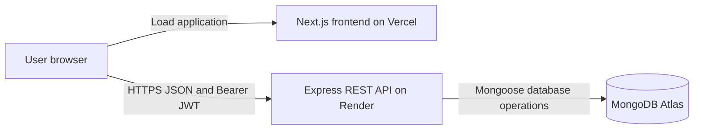

# Issue Tracker System

A full-stack issue management application developed for the **Exelon Circuits Private Limited technical assessment**. Administrators and team members can create, assign, track, and discuss issues through a responsive web interface backed by an Express REST API and MongoDB.

| Resource | Location |
| --- | --- |
| GitHub repository | [Bharath-moger/Issue-tracker-system](https://github.com/Bharath-moger/Issue-tracker-system) |
| Live frontend — Vercel | [FRONTEND_URL] — (https://issue-tracker-system-dusky.vercel.app) |
| Live backend API — Render | [BACKEND_API_URL] —  (https://issue-tracker-api-mqj4.onrender.com/api) |
| Business Requirements Document | [docs/BRD.md](docs/BRD.md) |
| Frontend guide | [client/README.md](client/README.md) |
| Backend guide | [server/README.md](server/README.md) |

The hosting topology is **Vercel → Render → MongoDB Atlas**: the frontend is served by Vercel, browser API requests go directly to Render, and the backend connects to Atlas. Live URLs and provider deployment state are not recorded in the inspected repository. The deployment instructions below describe this topology without claiming a verified live deployment.

## Problem statement and objectives

Tracking issues across disconnected messages makes ownership, priorities, and progress difficult to follow. This project provides one workspace to:

- Record issues with a description, priority, creator, assignee, and status.
- Make responsibility explicit through administrator-controlled assignment.
- Restrict access to the information and actions appropriate to each role.
- Keep discussions attached to their issue.
- Provide an accurate overview of open, active, and closed work.
- Demonstrate maintainable frontend development, REST APIs, authentication, validation, and persistent database operations.

## Features

- Registration, shared administrator/user login, profile viewing, session restoration, and logout.
- Role-aware dashboard with total, open, in-progress, and closed issue counts, an assigned-to-me count, and five recent accessible issues.
- Issue creation, details, editing, administrator deletion, assignment/unassignment, and status changes.
- Title search, status and priority filters, and 10-row pagination in the interface. The API also supports assignee filtering and a configurable page size.
- Chronological issue comments with author names and creation dates.
- Administrator user listing, details, name/email editing, and deletion subject to reference checks.
- Responsive sidebar/navigation drawer, horizontally scrollable tables, confirmation dialogs, and loading, empty, error, and success states.
- Real MongoDB persistence, backend validation, consistent API responses, and integration/browser test suites.

## Roles and permissions

An **accessible issue** is any issue for an administrator, or an issue created by or assigned to the current regular user.

| Action | ADMIN | USER |
| --- | --- | --- |
| Register through the public form/API | Registration always creates USER | Yes |
| Sign in and view own profile | Yes | Yes |
| View dashboard | All issues | Created or assigned issues |
| View issues and their comments | All issues | Accessible issues only |
| Create an issue | Yes; optional assignment | Yes; no assignment to another account |
| Edit title, description, priority | Any issue | Issues they created |
| Update status | Any issue | Issues assigned to them |
| Assign or unassign | Yes; assignee must be USER | No |
| Delete issues and associated comments | Yes | No |
| Add comments | Any issue | Accessible issues only |
| List, view, edit, or delete users | Yes, subject to deletion restrictions | No |

Admin accounts are provisioned by the seed script. There is no role-changing endpoint or administrator registration option. User-management updates accept only `name` and `email`. The currently authenticated administrator cannot delete their own account, and users referenced by issues or comments cannot be deleted.

## Technology stack

| Layer | Technologies |
| --- | --- |
| Frontend | Next.js 16 App Router, React 19, TypeScript, Tailwind CSS 4, Axios, Lucide React |
| Backend | Node.js, Express 5, MongoDB, Mongoose, JWT (`jsonwebtoken`), bcryptjs |
| Backend support | express-validator, dotenv, cors, Helmet, Morgan; nodemon for development |
| Verification | Node.js test runner, Playwright, TypeScript checks, Next.js production build |
| Hosting | Vercel frontend, Render backend, MongoDB Atlas database |
| Version control | Git and GitHub |

Both packages declare Node.js `>=22`. Use Node.js 22 LTS for a consistent local and deployment runtime. Exact dependency resolutions are recorded in the separate package lockfiles.

## Architecture



The monorepo contains two independently installed applications. The frontend has reusable components, authentication context, typed API services, and data-fetching hooks. The backend uses routes, validation, authentication/role middleware, controllers, and Mongoose models. Protected data is fetched in the browser after session verification; the frontend is not an API proxy. There is no root package script or shared package workspace.

### Folder structure

```text
Issue-tracker-system/
├── README.md
├── docs/
│   └── BRD.md
├── client/
│   ├── public/icon.svg
│   ├── src/
│   │   ├── app/
│   │   │   ├── (auth)/
│   │   │   │   ├── layout.tsx
│   │   │   │   ├── login/page.tsx
│   │   │   │   └── register/page.tsx
│   │   │   ├── (dashboard)/
│   │   │   │   ├── layout.tsx
│   │   │   │   ├── dashboard/page.tsx
│   │   │   │   ├── issues/page.tsx
│   │   │   │   ├── issues/new/page.tsx
│   │   │   │   ├── issues/[id]/page.tsx
│   │   │   │   ├── users/page.tsx
│   │   │   │   └── profile/page.tsx
│   │   │   ├── layout.tsx
│   │   │   ├── page.tsx
│   │   │   ├── globals.css
│   │   │   ├── error.tsx
│   │   │   └── not-found.tsx
│   │   ├── components/{auth,dashboard,issues,layout,ui,users}/
│   │   ├── context/{AuthContext,NoticeContext}.tsx
│   │   ├── hooks/{useAuth,useIssues,useResource}.ts
│   │   ├── services/
│   │   │   ├── api.ts
│   │   │   └── {auth,comment,dashboard,issue,user}.service.ts
│   │   ├── types/{comment,issue,user}.ts
│   │   └── lib/utils.ts
│   ├── tests/{setup.ts,workflows.spec.ts}
│   ├── .env.example
│   ├── .gitignore
│   ├── next-env.d.ts
│   ├── next.config.ts
│   ├── postcss.config.mjs
│   ├── playwright.config.ts
│   ├── tsconfig.json
│   ├── package.json
│   ├── package-lock.json
│   └── README.md
└── server/
    ├── src/
    │   ├── config/database.js
    │   ├── models/{User,Issue,Comment}.js
    │   ├── controllers/{auth,comment,dashboard,issue,user}.controller.js
    │   ├── routes/{auth,comment,dashboard,issue,user}.routes.js
    │   ├── middleware/
    │   │   ├── auth.middleware.js
    │   │   ├── role.middleware.js
    │   │   ├── error.middleware.js
    │   │   └── not-found.middleware.js
    │   ├── utils/{generate-token,http,issue-access}.js
    │   ├── validators/{auth,issue}.validator.js
    │   ├── validators/common.js
    │   ├── app.js
    │   └── server.js
    ├── scripts/seed-admin.js
    ├── test/api.test.js
    ├── .env.example
    ├── .gitignore
    ├── package.json
    ├── package-lock.json
    └── README.md
```

Brace notation groups existing files or directories; generated build output, dependencies, and private environment files are omitted.

### Frontend routes

| Route | Purpose |
| --- | --- |
| `/` | Restore session and redirect to dashboard or login |
| `/login`, `/register` | Sign in or create a regular user account |
| `/dashboard` | Shared route with role-specific descriptions, permissions, and data |
| `/issues`, `/issues/new`, `/issues/[id]` | List, create, and manage accessible issues |
| `/users` | Administrator user management; regular users see an access-denied screen |
| `/profile` | View the authenticated user's profile |

## Authentication and authorization

1. Registration validates `name`, `email`, and `password`, and creates a USER. The API returns a token and safe user data; the registration interface redirects to login rather than starting a session with that token.
2. Login compares the password using bcryptjs and returns `{ user, token }` inside `data`.
3. The browser stores the token under `issue-tracker-token` in local storage. The centralized Axios instance sends `Authorization: Bearer <token>`.
4. `/api/auth/me` restores the profile. Protected API middleware verifies HS256 signatures and expiration and reloads the current account from MongoDB.
5. Backend role and issue-access checks enforce permissions independently of frontend controls. Password hashes are excluded from API JSON responses.
6. Protected-request authentication failures clear the matching client session and redirect to login. Logout clears local storage; it does not revoke an issued token on the server.

JWT lifetime defaults to `1d` and is configurable. There are no refresh-token, password-reset, role-update, or server-side logout endpoints. Local-storage tokens are accessible to scripts on the same origin; this is the implemented assessment storage strategy, not an HTTP-only cookie session.

## Database models and relationships

All models include `_id`, `createdAt`, and `updatedAt`.

| Model | Fields and constraints |
| --- | --- |
| User | Required trimmed `name` (max 100); required unique lowercase, trimmed, validated `email`; required hidden `password`, hashed before save with bcrypt cost 12; `role`: ADMIN or USER, default USER |
| Issue | Required trimmed `title` (max 200) and `description` (max 10,000); `priority`: LOW, MEDIUM, HIGH, default MEDIUM; `status`: OPEN, IN_PROGRESS, CLOSED, default OPEN; required `createdBy` User reference; optional `assignedTo` User reference, default null |
| Comment | Required `issue` Issue reference; required `user` User reference; required trimmed `content` (max 5,000) |

A user may create many issues, be assigned many issues, and write many comments. An issue has one creator, zero or one assignee, and many comments. References use MongoDB ObjectIds. Issues populate creator/assignee name, email, and role; comments populate the author name. User email is uniquely indexed; issues have creator/creation-date and assignee/creation-date indexes, and comments index the issue reference.

Assignment APIs validate that the account exists and has role USER. Reference integrity is enforced by application checks, not database foreign-key constraints. Issue deletion removes comments first. User deletion is rejected with 409 while any issue or comment references that account. These operations are sequential, not multi-document transactions, so concurrent writes/deletions are not fully atomic.

## API reference

Local API base URL: `http://localhost:5000/api`. Paths in this table include `/api`. All protected endpoints require the Bearer header. Request bodies must be JSON objects; unsupported body fields are rejected. `:id` is a 24-character hexadecimal ObjectId for the relevant user or issue.

| Method | Endpoint | Access | Body / result |
| --- | --- | --- | --- |
| GET | `/api/health` | Public | HTTP availability response |
| POST | `/api/auth/register` | Public | Required `name`, `email`, `password`; returns `data.user`, `data.token`; 201 |
| POST | `/api/auth/login` | Public | Required `email`, `password`; returns `data.user`, `data.token` |
| GET | `/api/auth/me` | Authenticated | Current safe user profile in `data` |
| GET | `/api/users` | ADMIN | All users in `data`, newest first |
| GET | `/api/users/:id` | ADMIN | User profile in `data` |
| PATCH | `/api/users/:id` | ADMIN | `name` and/or `email`; returns updated user |
| DELETE | `/api/users/:id` | ADMIN | Rejects current admin or referenced accounts; success omits `data` |
| POST | `/api/issues` | Authenticated | Required `title`, `description`; optional `priority`; ADMIN may set `assignedTo`; returns issue; 201 |
| GET | `/api/issues` | Authenticated, scoped | Filtered/paginated accessible issues; query parameters below |
| GET | `/api/issues/:id` | Accessible issue | Populated issue; comments retrieved separately |
| PATCH | `/api/issues/:id` | ADMIN or creator | `title`, `description`, and/or `priority`; returns updated issue |
| DELETE | `/api/issues/:id` | ADMIN | Removes issue and associated comments; success omits `data` |
| PATCH | `/api/issues/:id/status` | ADMIN or current assignee | Required `status`; returns updated issue |
| PATCH | `/api/issues/:id/assign` | ADMIN | Required `assignedTo`: existing USER ID or null; returns updated issue |
| GET | `/api/issues/:id/comments` | Accessible issue | Comment array, oldest first, including author name and timestamps |
| POST | `/api/issues/:id/comments` | Accessible issue | Required `content`; returns comment; 201 |
| GET | `/api/dashboard/stats` | Authenticated, scoped | Statistics object described below |

### Issue queries and rules

| Parameter | Accepted values / default |
| --- | --- |
| `page` | Integer 1–1,000,000; default 1 |
| `limit` | Integer 1–100; default 10 |
| `search` | Literal case-insensitive title search; max 200 characters |
| `status` | OPEN, IN_PROGRESS, CLOSED |
| `priority` | LOW, MEDIUM, HIGH |
| `assignedTo` | Valid user ObjectId; results still constrained by caller access |

Example: `GET /api/issues?page=1&limit=10&status=OPEN&priority=HIGH`.

The list response `data` contains `issues`, `totalRecords`, `currentPage`, and `totalPages`. Results are newest first; when no records match the query, totalPages is zero. User and comment lists do not support pagination.

Creation always sets `createdBy` to the authenticated user and status to OPEN. Regular users cannot specify a non-null assignee. General updates cannot change `createdBy`, `assignedTo`, or `status`. Authorized status changes may set any allowed status; no sequential transition policy is enforced. The interface presents assignee controls only to administrators. There are no comment-edit/delete endpoints.

Dashboard `data` contains `totalIssues`, `openIssues`, `inProgressIssues`, `closedIssues`, and `myAssignedIssues`. Admin totals span all issues. User totals include issues they created or are assigned to, without double counting an issue meeting both conditions. `myAssignedIssues` counts assignments to the current account.

### Responses and validation

```json
{
  "success": true,
  "message": "Issue created successfully",
  "data": {}
}
```

`data` is the resource, array, or object described in the endpoint table, not necessarily an empty object. Health and successful deletions omit it.

```json
{
  "success": false,
  "message": "Issue not found"
}
```

| Status | Meaning |
| --- | --- |
| 200 / 201 | Successful request / resource created |
| 400 | Invalid input, malformed JSON, invalid IDs, or unsupported fields |
| 401 / 403 | Missing/invalid/expired authentication / insufficient permission |
| 404 | Resource or route not found |
| 409 | Duplicate email, prohibited self-deletion, or referenced user |
| 413 | JSON request exceeds the 100 KB limit |
| 500 | Unexpected server error; internal details are not returned |

Registration passwords require at least 8 characters and at most 72 UTF-8 bytes. Names, issue text, and comments must remain nonempty after trimming. Email format is validated and case normalized. Model and request validators enforce the enum and length constraints above.

## Local development

### Prerequisites and installation

Install Git, Node.js 22 LTS with npm, and either local MongoDB or access to an Atlas cluster. The backend database account needs read/write and index-creation permissions.

```bash
git clone https://github.com/Bharath-moger/Issue-tracker-system.git
cd Issue-tracker-system
npm ci --prefix server
npm ci --prefix client
cp server/.env.example server/.env
cp client/.env.example client/.env.local
```

On Windows PowerShell, use `Copy-Item` instead of `cp` if needed. Install dependencies separately; there is no root `package.json`. Private environment files are ignored by their respective application `.gitignore` files.

### Environment variables

Use [server/.env.example](server/.env.example) and [client/.env.example](client/.env.example) as the source templates. The following are examples and placeholders, never production credentials.

| Backend variable | Local example | Purpose |
| --- | --- | --- |
| `PORT` | `5000` | HTTP port; Render supplies its runtime port |
| `NODE_ENV` | `development` | Use `production` on Render |
| `MONGODB_URI` | `mongodb://127.0.0.1:27017/issue_tracker` | Required local MongoDB URI; use a private Atlas URI in production |
| `JWT_SECRET` | `<GENERATE_A_RANDOM_SECRET_OF_AT_LEAST_32_CHARACTERS>` | Required backend signing secret; never expose to the client |
| `JWT_EXPIRES_IN` | `1d` | Token lifetime |
| `CLIENT_URL` | `http://localhost:3000` | Exact allowed browser origin |
| `ADMIN_NAME` | `Assessment Administrator` | Initial administrator's name, used by seeding |
| `ADMIN_EMAIL` | `admin@example.com` | Example only; configure the intended administrator email privately |
| `ADMIN_PASSWORD` | `<SET_A_UNIQUE_ADMIN_PASSWORD>` | Seed-only password: minimum 8 characters, maximum 72 UTF-8 bytes |

| Frontend variable | Local example | Purpose |
| --- | --- | --- |
| `NEXT_PUBLIC_API_URL` | `http://localhost:5000/api` | Public API base URL including `/api`; embedded at build time |

Fill the required values in `server/.env`. Generate a signing secret locally with:

```bash
node -e "console.log(require('crypto').randomBytes(32).toString('hex'))"
```

Store the result privately. For Atlas, use the connection string from its connection dialog, specify the application database, and URL-encode credentials containing reserved characters. Do not paste the real URI, secret, or password into documentation or commits.

### Admin seed and startup

Ensure MongoDB is running or Atlas is reachable, then seed from the backend directory so dotenv reads the correct `.env`:

```bash
cd server
npm run seed:admin
npm run dev
```

The seed connects to MongoDB, checks whether any ADMIN already exists, and creates one only if none exists. It hashes the password through the User model, will not promote an existing USER with the same email, and closes the connection when finished. Run a single seed process at a time. Remove seed credentials from the runtime environment after provisioning.

In a separate terminal, from the repository root:

```bash
cd client
npm run dev
```

Open `http://localhost:3000`. The backend listens at `http://localhost:5000` and opens its HTTP port only after connecting to MongoDB. Verify it with `curl http://localhost:5000/api/health`. Both roles use `/login`; new registrations return to login. Dashboard content and available actions depend on the authenticated role.

### Package commands

| Directory | Command | Purpose |
| --- | --- | --- |
| `server/` | `npm run dev` | nodemon development server |
| `server/` | `npm start` | Run Express with Node.js |
| `server/` | `npm run seed:admin` | Provision initial administrator |
| `server/` | `npm test` | Database-backed Node integration tests |
| `client/` | `npm run dev` | Next.js development server in Webpack mode |
| `client/` | `npm run typecheck` | TypeScript check |
| `client/` | `npm run build` | Next.js production build in Webpack mode |
| `client/` | `npm start` | Serve the completed production build locally |
| `client/` | `npm run test:e2e` | Playwright browser workflows |

### Verification commands

Tests operate on isolated databases. Backend tests drop `issue_tracker_test` before and after execution. Browser setup deletes all users, issues, and comments in `issue_tracker_frontend_test` and seeds test records. Never substitute an application database.

```bash
# From server/, with MongoDB already running:
TEST_MONGODB_URI=mongodb://127.0.0.1:27017/issue_tracker_test npm test

# From client/:
npm run typecheck
npm run build
npx playwright install chromium
TEST_MONGODB_URI=mongodb://127.0.0.1:27017/issue_tracker_frontend_test npm run test:e2e
```

The inline environment syntax above is for POSIX shells; in PowerShell, set `$env:TEST_MONGODB_URI` before running npm. Browser tests start their own servers on ports 3011 and 5011; keep both free. `PLAYWRIGHT_CHROMIUM_EXECUTABLE_PATH` optionally selects an installed Chrome executable. These are test-tool variables, not additions to the application environment examples. Tests cover authentication, authorization, issue workflows, comments, user management, dashboard counts, and list behavior; browser tests also check responsive navigation/layout. This documentation review does not assert a new runtime test execution or a live deployment verification.

## Deployment: Vercel, Render, and MongoDB Atlas

No `vercel.json`, Render blueprint, container configuration, or deployment workflow is present in the tracked project. Configure the services through their provider dashboards using the existing application scripts. No application configuration changes are required by these instructions.

### 1. Configure MongoDB Atlas

Create an Atlas project/cluster and a dedicated database user with access to the application database. Add the Render service's outbound addresses to the project IP access list. For local administration, allow the administrator's current IP separately. Obtain the application connection string and store it privately as Render's `MONGODB_URI`; the browser must never receive it. Follow the [Atlas cluster connection guide](https://www.mongodb.com/docs/atlas/connect-to-database-deployment/).

### 2. Deploy the backend on Render

Create a **Node Web Service** connected to this GitHub repository, select the deployment branch, and set:

| Setting | Value |
| --- | --- |
| Root directory | `server` |
| Runtime | Node.js 22 |
| Build command | `npm ci` |
| Start command | `npm start` |
| Health check path | `/api/health` |

Set `NODE_ENV=production`, the private `MONGODB_URI`, a random `JWT_SECRET`, `JWT_EXPIRES_IN=1d`, and `CLIENT_URL` to the Vercel production origin. Let Render supply `PORT`. Once deployed, check the service's `/api/health` endpoint. These settings use this project's scripts with Render's [Node/Express deployment workflow](https://render.com/docs/deploy-node-express-app).

Provide `ADMIN_NAME`, `ADMIN_EMAIL`, and `ADMIN_PASSWORD` privately for one provisioning run. Execute `npm run seed:admin` from `server/` in an available service shell or from a trusted local backend checkout configured temporarily for the same Atlas database and permitted network address. The seed does not require the API server to be running. Remove provisioning credentials afterward.

### 3. Deploy the frontend on Vercel

Import the GitHub repository as a Next.js project. Select `client` as the Root Directory, use Node.js 22, install with `npm ci`, and build with `npm run build`. Retain Vercel's framework-managed output settings. Set `NEXT_PUBLIC_API_URL` to the Render HTTPS origin followed by `/api`, then deploy. Vercel selects the application through its [monorepo Root Directory setting](https://vercel.com/docs/monorepos).

Record the final frontend URL and backend API URL in the resource table above. Update Render's `CLIENT_URL` to the final frontend origin and redeploy/restart the backend after changing that environment value.

### CORS and production environment mapping

| Service | Setting | Production value |
| --- | --- | --- |
| Vercel | `NEXT_PUBLIC_API_URL` | Render HTTPS API base URL ending in `/api` |
| Render | `CLIENT_URL` | Exact Vercel production origin: scheme and hostname, no path or trailing slash |
| Render | `MONGODB_URI`, `JWT_SECRET` | Private values configured only in the backend service |
| Render | `NODE_ENV`, `JWT_EXPIRES_IN` | `production`, and the selected lifetime such as `1d` |
| Render | `PORT` | Provider-supplied runtime value |
| Atlas | Database user and IP access list | Backend database permissions and permitted outbound addresses |

The current CORS implementation allows one configured browser origin. It does not parse comma-separated origins or automatically allow changing Vercel preview domains. Use the configured production origin for assessment access. Bearer headers authenticate requests; cookie credentials are not used. CORS does not replace API authentication or authorization.

### Updates and redeployment

1. Commit changes and push to the branch connected to each hosting service.
2. If automatic deployment is enabled, review the resulting builds; otherwise trigger deployment manually in each dashboard.
3. Rebuild the frontend whenever `NEXT_PUBLIC_API_URL` changes, because it is embedded in the browser bundle. Restart/redeploy the backend after backend environment changes.
4. If the frontend domain changes, update `CLIENT_URL`; if the backend origin changes, update the frontend API URL. Update Atlas network access if backend outbound addresses change.
5. Verify health, both role logins, dashboard counts, issue access, assignment, status updates, comments, and admin user-management restrictions. Update the documented public URLs after validation. Do not reseed an existing administrator on routine deployments.

## Current constraints

The application has no password reset, refresh-token flow, role editor, comment editing/deletion API, audit-history feature, real-time synchronization, outbound notifications, or file uploads. User and comment endpoints are unpaginated. Deletion/reference checks are not transactional. Health reports HTTP availability rather than ongoing database readiness. Hosting availability, backup policies, and production acceptance depend on the deployed services and are not established by the source code.
