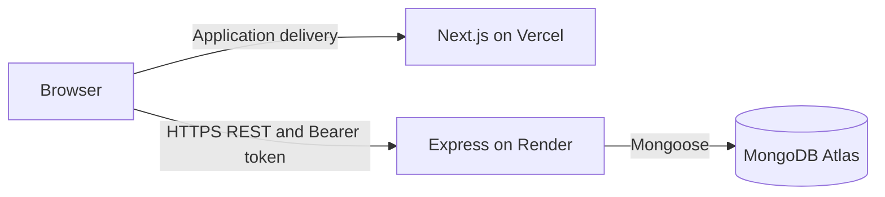

# Business Requirements Document

## 1. Document overview

| Item | Description |
| --- | --- |
| Project | Issue Tracker System |
| Assessment organization | Exelon Circuits Private Limited |
| Document version | 1.0 |
| Review date | 6 November 2026 |
| Basis | Inspection of the current frontend, backend, models, routes, controllers, middleware, validation, package scripts, environment examples, and test configuration |
| Purpose | Describe the business need, implemented requirements, operating rules, architecture, and deployment responsibilities for assessment review |
| Repository | [Bharath-moger/Issue-tracker-system](https://github.com/Bharath-moger/Issue-tracker-system) |
| Implementation and setup reference | [Root README](../README.md) |

This document records the implemented application rather than an unverified future feature list. Hosting topology is Vercel for the frontend, Render for the backend, and MongoDB Atlas for the database. Public deployment URLs and live hosting status remain to be confirmed. Operational expectations are distinguished from behavior implemented in source code; no formal approval, service-level agreement, or production certification is implied.

## 2. Project background

The assessment calls for a practical full-stack application demonstrating frontend development, REST API design, database persistence, authentication, authorization, validation, testing, and deployment preparation. The system brings issue recording, ownership, progress, and discussion into one workspace with two access roles: ADMIN and USER.

Primary stakeholders are team members who report or resolve issues, administrators who coordinate work and maintain accounts, and assessment reviewers who evaluate the implementation and documentation.

## 3. Problem statement

When issue information is distributed across messages and individual records, teams lack a dependable view of responsibility and progress. Important context can become detached from the work it describes, while unrestricted access can expose issues to unrelated users. The system addresses this with a shared issue record, explicit assignment, controlled visibility, status tracking, and issue-specific comments.

## 4. Business objectives

| ID | Objective | Observable outcome |
| --- | --- | --- |
| BO-01 | Centralize issue information | Authorized users can create and retrieve persistent issue records |
| BO-02 | Establish responsibility | Administrators can assign an issue to an existing regular user or leave it unassigned |
| BO-03 | Make progress visible | Issue statuses and role-scoped dashboard counts reflect stored records |
| BO-04 | Support contextual collaboration | Authorized participants can read and add chronological comments on an issue |
| BO-05 | Control information access | Backend checks restrict regular users to created or assigned issues and deny administrative APIs |
| BO-06 | Support assessment and maintenance | A modular repository, documented setup, actual API contracts, and repeatable test commands are available |

No numerical productivity, response-time, or availability target has been agreed in the repository. These outcomes are functional acceptance criteria, not measured business-impact claims.

## 5. Project scope

### In scope

- Responsive Next.js frontend and Express REST backend in one repository.
- Regular-user registration, shared login, profile retrieval, session restoration, and client logout.
- Administrator provisioning through a seed script.
- Issue creation, scoped listing/details, creator/admin editing, administrator deletion, assignment, and status changes.
- Title search, status/priority filters, and pagination in the interface; additional assignee filtering in the API.
- Issue comments, administrator user management, and dashboard statistics.
- MongoDB persistence, request validation, backend permission enforcement, and standardized error responses.
- Automated integration/browser test code and deployment instructions for Vercel, Render, and Atlas.

### Outside the implemented scope

Password reset, email verification, refresh tokens, server-side token revocation/logout, role changes through an API, comment editing/deletion endpoints, audit-history tracking, real-time updates, outbound notifications, attachments/uploads, payments, and automated deployment workflows are not implemented. User and comment lists do not provide pagination.

## 6. Functional requirements

| ID | Implemented requirement | Source reference |
| --- | --- | --- |
| FR-01 | Public registration accepts name, email, and password and creates USER accounts only; the interface validates password confirmation and returns to login | [Auth controller](../server/src/controllers/auth.controller.js), [Auth form](../client/src/components/auth/AuthForm.tsx) |
| FR-02 | Both roles sign in with email/password, receive a JWT and safe profile, and can restore their session through the current-user endpoint | [Authentication middleware](../server/src/middleware/auth.middleware.js), [Auth context](../client/src/context/AuthContext.tsx) |
| FR-03 | Administrators are created from environment-supplied values only when no ADMIN exists | [Seed script](../server/scripts/seed-admin.js) |
| FR-04 | Authenticated users create issues with title, description, and priority; the server sets creator and initial OPEN status; administrators may include an assignee | [Issue controller](../server/src/controllers/issue.controller.js) |
| FR-05 | Administrators list all issues; regular users list issues they created or are assigned. Lists support title search, status/priority/assignee filters, and pagination | [Issue access utility](../server/src/utils/issue-access.js), [Issue list](../client/src/app/(dashboard)/issues/page.tsx) |
| FR-06 | Accessible issue details include description, status, priority, creator, assignee, and creation/update dates. Only ADMIN or creator can edit descriptive fields | [Issue details](../client/src/components/issues/IssueDetails.tsx), [Issue routes](../server/src/routes/issue.routes.js) |
| FR-07 | Administrators assign/unassign issues; ADMIN or current assignee can set status. Regular creators without assignment cannot update status | [Issue controller](../server/src/controllers/issue.controller.js) |
| FR-08 | Only administrators delete issues; associated comments are removed during deletion | [Issue controller](../server/src/controllers/issue.controller.js) |
| FR-09 | Participants with issue access can read and add nonempty comments with author name and creation date | [Comment controller](../server/src/controllers/comment.controller.js), [Discussion UI](../client/src/components/issues/CommentSection.tsx) |
| FR-10 | Administrators list/view users, edit name/email, and delete accounts when self-deletion/reference restrictions permit | [User controller](../server/src/controllers/user.controller.js), [Users UI](../client/src/components/users/UsersManager.tsx) |
| FR-11 | Dashboard returns total/open/in-progress/closed counts within caller scope and a count assigned to the current account; frontend shows five recent accessible issues | [Dashboard controller](../server/src/controllers/dashboard.controller.js), [Recent issues](../client/src/components/dashboard/RecentIssues.tsx) |
| FR-12 | Users can view their own profile, sign out, and receive loading, empty, success, validation, access, and connection feedback in the interface | [Profile page](../client/src/app/(dashboard)/profile/page.tsx), [API client](../client/src/services/api.ts) |

## 7. User roles and permissions

An administrator can access every issue. A regular user's accessible issues are the union of issues they created and issues currently assigned to them.

| Capability | ADMIN | USER |
| --- | --- | --- |
| Sign in and view own profile | Yes | Yes |
| Dashboard/list/detail visibility | All issues | Created or assigned issues |
| Create issue | Yes | Yes |
| Edit title, description, priority | Any issue | Created issues only |
| Update issue status | Any issue | Assigned issues only |
| Assign/unassign | Yes; USER targets only | No |
| Delete issue and its comments | Yes | No |
| Read/add comments | Any issue | Accessible issues only |
| View/manage registered users | Yes | No |

There is no separate administrator sign-in page. Both roles use `/dashboard`; content, data scope, navigation, and controls reflect the authenticated role. Profile access for regular users uses `/api/auth/me`, not administrative user-management endpoints.

## 8. Non-functional requirements

| ID | Requirement | Current implementation or constraint |
| --- | --- | --- |
| NFR-01 | Enforce authentication and least-privilege application access | JWT verification, current-account lookup, role middleware, and per-issue access checks operate on the backend |
| NFR-02 | Preserve stored records and references | MongoDB persistence, unique email index, reference checks, and comment cleanup are implemented; multi-document deletion operations are not transactional |
| NFR-03 | Provide usable desktop/mobile interfaces | Responsive layouts, a navigation drawer, scrollable tables, labeled inputs, live feedback, and native dialogs exist; no formal accessibility certification is claimed |
| NFR-04 | Keep implementation maintainable | Frontend services/types/components and backend routes/controllers/models are separated without a shared root package dependency |
| NFR-05 | Bound issue-list queries | Pagination defaults to 10 and allows at most 100 records per page; common issue reference/date fields are indexed. User/comment lists remain unpaginated |
| NFR-06 | Handle errors predictably | Standard response envelopes, validation, safe unexpected-error messages, retry controls, and a frontend request timeout are implemented |
| NFR-07 | Support predictable service startup/shutdown | Backend connects and pings MongoDB before listening, exits on startup failure, and handles SIGINT/SIGTERM |
| NFR-08 | Support repeatable verification | Database-backed Node tests, Playwright workflows, TypeScript checks, and production-build commands exist; test databases must remain isolated |
| NFR-09 | Operate through managed hosting | Vercel/Render/Atlas setup is documented; actual availability, monitoring, backup/restore policy, capacity, and live acceptance remain operator responsibilities |

No load-test evidence or guaranteed response time, uptime percentage, recovery objective, or simultaneous-user capacity is defined by this review.

## 9. Business rules

| ID | Rule |
| --- | --- |
| BR-01 | Public registration creates USER only and rejects unsupported fields, including a requested role |
| BR-02 | Email addresses are validated, trimmed, lowercased, and uniquely indexed |
| BR-03 | Registration passwords require at least 8 characters and no more than 72 UTF-8 bytes; stored passwords are hashed and excluded from API JSON |
| BR-04 | Issue creator is the authenticated account; initial status is OPEN; default priority is MEDIUM |
| BR-05 | Priorities are LOW, MEDIUM, HIGH; statuses are OPEN, IN_PROGRESS, CLOSED |
| BR-06 | Authorized status updates can select any allowed status; the system does not enforce a mandatory sequential lifecycle |
| BR-07 | Assignment targets must exist and have role USER. ADMIN accounts cannot be selected as assignees; null means unassigned |
| BR-08 | General issue edits accept only title, description, and priority; creator, assignment, and status cannot be changed through that endpoint |
| BR-09 | Regular users may edit created issues but may change status only when assigned to the issue |
| BR-10 | Comments require current issue access; content must be nonempty after trimming and is limited to 5,000 characters |
| BR-11 | The authenticated administrator cannot delete their own account. Any account referenced as creator, assignee, or comment author cannot be deleted |
| BR-12 | Issue deletion removes associated comments; no recover/restore API exists |
| BR-13 | User-management updates accept name and email only. There is no role-change or password-change API |
| BR-14 | A regular user's dashboard/list scope is created OR assigned issues. An issue meeting both conditions is counted once |
| BR-15 | User issue access is evaluated against current assignment. After unassignment, a former assignee who is not the creator loses access |

Issue title and description are required, trimmed, and limited to 200 and 10,000 characters respectively. API permission enforcement remains authoritative even if a caller bypasses the interface.

## 10. Use cases and workflows

### UC-01: Register and sign in

**Actor:** prospective regular user. **Precondition:** backend/database available and email not registered.

1. Enter name, email, password, and confirmation in the registration interface.
2. Frontend checks confirmation; backend validates permitted input and creates USER.
3. Interface returns to login with a success message.
4. User signs in; the browser stores the JWT and opens the role-aware dashboard.

**Exceptions:** invalid data produces 400; duplicate email produces 409; invalid credentials produce 401. ADMIN provisioning is a separate seed operation.

### UC-02: Report and edit an issue

**Actor:** authenticated ADMIN or USER.

1. Open issue creation and enter title, description, and priority.
2. An administrator may optionally select a regular-user assignee.
3. Server records the authenticated creator, sets OPEN, and persists the issue.
4. Creator or administrator opens the edit dialog and updates permitted descriptive fields.

**Outcome:** the issue is retrievable only within the caller's permitted scope. An unrelated user cannot retrieve or edit it.

### UC-03: Assign and progress work

**Actors:** administrator and assigned user.

1. Administrator selects an existing USER and saves assignment.
2. Assignee can now retrieve the issue and its discussion.
3. Administrator or assignee updates status, commonly OPEN → IN_PROGRESS → CLOSED.
4. Dashboard and issue views reflect stored status when refreshed or updated locally.

The sequence is illustrative; authorized reopening or direct changes between enum values are permitted. An administrator may unassign the issue by sending null.

### UC-04: Discuss an accessible issue

**Actor:** administrator, creator, or current assignee.

1. Open the accessible issue.
2. Read comments in chronological order.
3. Submit nonempty content; server verifies access, attaches issue/author references, and saves it.

**Outcome:** discussion shows author name and creation time. There is no individual comment editing/deletion workflow.

### UC-05: Administer accounts and remove records

**Actor:** administrator.

1. Open Users, view an account, and edit name/email if required.
2. Confirm an account deletion request; server rejects self-deletion or existing references with 409.
3. For an issue deletion, confirm removal; backend removes related comments and then the issue.

**Constraint:** reference checks and cleanup span multiple operations and do not guarantee atomicity against concurrent creation, assignment, or deletion.

### UC-06: Restore or end a session

On reload, the frontend retrieves the account through `/api/auth/me`. Invalid/expired authentication on protected requests clears the matching client session and returns to login. A network failure during restoration offers retry or return to login. Sign out removes the local token; it does not invalidate another copy of an unexpired token on the server.

## 11. System architecture

- `client/` contains App Router pages/layouts, reusable components, authentication/notice contexts, hooks, typed services, and presentation styles.
- `server/` contains API route modules, validation, authentication/role/error middleware, controllers, models, connection setup, and seed tooling.
- Browser API requests go directly to the backend. Frontend servers do not hold database credentials or proxy authenticated API calls.
- User/issue/comment data is persisted in MongoDB; the browser stores only its session token locally. No organization/tenant model is present.
- The backend starts only after a successful MongoDB connection. The health endpoint indicates HTTP availability, not continuous database readiness.

## 12. Technology stack

| Concern | Implementation |
| --- | --- |
| Frontend | Next.js 16 App Router, React 19, TypeScript, Tailwind CSS 4, Axios, Lucide React |
| Runtime/API | Node.js (`>=22` in both packages), Express 5 |
| Database access | MongoDB and Mongoose |
| Authentication | JSON Web Tokens with HS256; bcryptjs password hashing |
| Validation/security middleware | express-validator, Helmet, cors, dotenv |
| Logging/development | Morgan, nodemon |
| Verification | Node.js test runner, Playwright, TypeScript, Next.js production build |
| Hosting/version control | Vercel, Render, MongoDB Atlas; Git/GitHub |

Both applications have their own `package.json` and lockfile. Frontend development/build scripts explicitly use Webpack. Backend startup is `npm start`; there is no backend compilation script.

## 13. Database overview

| Entity | Business information | Relationships |
| --- | --- | --- |
| User | Name, unique email, hashed password, role, timestamps | Creates issues, may be an assignee, authors comments |
| Issue | Title, description, priority, status, timestamps | Exactly one creator, optional single assignee, many comments |
| Comment | Content and timestamps | Exactly one issue reference and one author reference |

All entities use MongoDB ObjectIds. Mongoose schemas validate required fields and enums. Issue creator/assignee details and comment author names are populated for API consumers. Application checks protect existing references, but MongoDB references are not enforced as foreign keys. Deleted issues are physically removed with their comments; user deletion is blocked when references exist.

## 14. API overview

The API uses JSON under `/api`. Except health, registration, and login, all endpoints require `Authorization: Bearer <token>`.

| Method | Path | Access |
| --- | --- | --- |
| GET | `/api/health` | Public |
| POST | `/api/auth/register` | Public; USER creation only |
| POST | `/api/auth/login` | Public |
| GET | `/api/auth/me` | Authenticated |
| GET | `/api/users` | ADMIN |
| GET | `/api/users/:id` | ADMIN |
| PATCH | `/api/users/:id` | ADMIN; name/email only |
| DELETE | `/api/users/:id` | ADMIN; self/reference restrictions |
| POST | `/api/issues` | Authenticated; assignment restricted to ADMIN |
| GET | `/api/issues` | Authenticated; scoped records |
| GET | `/api/issues/:id` | Accessible issue |
| PATCH | `/api/issues/:id` | ADMIN or creator |
| DELETE | `/api/issues/:id` | ADMIN |
| PATCH | `/api/issues/:id/status` | ADMIN or current assignee |
| PATCH | `/api/issues/:id/assign` | ADMIN |
| GET | `/api/issues/:id/comments` | Accessible issue |
| POST | `/api/issues/:id/comments` | Accessible issue |
| GET | `/api/dashboard/stats` | Authenticated; scoped statistics |

Issue queries accept `page`, `limit`, `search`, `status`, `priority`, and `assignedTo`. Success responses contain `success`, `message`, and usually `data`; health and successful deletions omit `data`. Errors contain `success: false` and `message`. Creation returns 201; other successes return 200. Implemented error statuses include 400, 401, 403, 404, 409, 413, and 500. Complete request/response details are in the [README API reference](../README.md#api-reference). Endpoint paths are based on the actual route modules and `app.js` mount points.

## 15. Security requirements

Implemented controls include:

- Password hashing with bcryptjs cost 12 and omission of password hashes from response JSON.
- HS256 JWT signature/expiration checks, a required signing secret of at least 32 characters at startup, and current-account lookup on protected requests.
- Administrator route restrictions and issue-level authorization for details, editing, workflow, and comments.
- Field allowlists, ObjectId validation, enum validation, input trimming, escaped literal title search, and a 100 KB JSON limit.
- Helmet headers, environment-based CORS, and centralized error handling that does not return internal stack traces or database credentials.
- A frontend session strategy using local-storage Bearer tokens, with session restoration and authentication-failure handling.

Operational requirements are to keep database/signing/provisioning values private, use HTTPS hosting, set the exact approved frontend origin, restrict Atlas database/network access, and avoid application databases in destructive tests. CORS is a browser access control, not a substitute for authentication. Local storage remains accessible to same-origin scripts. Rate limiting, refresh-token rotation, token revocation, and a dedicated audit log are not implemented and are not claimed as existing controls.

## 16. Assumptions and constraints

- The assessment uses a single shared application workspace with two roles; additional organizations or permission tiers are outside scope.
- Operators provide MongoDB connectivity, a strong signing secret, initial administrator details, and hosting configuration privately.
- The implementation requires Node.js 22 or a newer compatible runtime and independent dependency installation in `client/` and `server/`.
- Browsers must be able to reach the configured backend directly; changing Vercel preview origins are not automatically accepted by the single-origin CORS configuration.
- Data is not pushed live between users. Views refresh through navigation/reload or local mutation results.
- Multi-document deletion/reference operations are not atomic, and user/comment queries are not paginated.
- Backup/restore policies, hosting plans/regions, production deployment branch, monitoring ownership, and service-level targets are not specified by the source.
- No runtime test execution or provider deployment verification is asserted as part of this documentation-only review. The existing test suites and setup instructions remain available for verification.

## 17. Deployment

### Hosting topology and status

| Layer | Platform | Deployment input |
| --- | --- | --- |
| Frontend | Vercel | Root `client`; Next.js; install `npm ci`; build `npm run build` |
| Backend | Render | Root `server`; Node Web Service; build `npm ci`; start `npm start`; health `/api/health` |
| Database | MongoDB Atlas | Application database, dedicated database user, and permitted backend outbound addresses |

Live frontend: **TODO: FRONTEND_URL**. Live backend API: **TODO: BACKEND_API_URL**, including `/api`. These public values were not found in the inspected project. The repository has no provider deployment manifests or deployment workflow; provider dashboard settings must be confirmed by the operator.

### Environment and CORS configuration

Use [server/.env.example](../server/.env.example) and [client/.env.example](../client/.env.example) as templates. Production values are entered into provider settings, not source files:

| Location | Required configuration |
| --- | --- |
| Render | `NODE_ENV=production`, private `MONGODB_URI`, private `JWT_SECRET`, `JWT_EXPIRES_IN` (example `1d`), `CLIENT_URL` equal to the Vercel production origin; use Render's supplied `PORT` |
| Initial administrator provisioning | Private `ADMIN_NAME`, `ADMIN_EMAIL`, `ADMIN_PASSWORD`; run `npm run seed:admin` once, then remove these provisioning values |
| Vercel | `NEXT_PUBLIC_API_URL` equal to the Render HTTPS origin plus `/api`; configure the intended environment before building |
| Atlas | Dedicated database user permissions and project IP access list permitting Render's outbound addresses and any separately approved administrator access |

The application allows one exact browser origin through `CLIENT_URL`, including its scheme and any nondefault port, with no path or trailing slash. It does not support a comma-separated origin list. Database credentials and JWT signing secrets must never be set as public frontend variables.

### Deployment workflow

1. Configure the Atlas database user, network access, and private application connection string using the [Atlas connection guide](https://www.mongodb.com/docs/atlas/connect-to-database-deployment/).
2. Connect the repository to a Render Node Web Service, set root `server`, runtime Node.js 22, and the commands/environment above; follow Render's [Express deployment workflow](https://render.com/docs/deploy-node-express-app). Validate health after startup.
3. Provision the initial administrator from an available backend shell or a trusted local backend checkout pointed at the same Atlas database. Provisioning does not require the API server to run; it requires database access.
4. Import the repository into Vercel, select root `client`, set the public API URL, and deploy using the Next.js framework settings. Vercel documents directory selection in its [monorepo guide](https://vercel.com/docs/monorepos).
5. Set Render's `CLIENT_URL` to the final Vercel production origin and restart/redeploy the backend. Replace both public URL placeholders in this document and the README.
6. Verify both role logins, scoped access, dashboard statistics, issue CRUD, assignment, status, comments, and administrative account restrictions before assessment handover.

### Updates and redeployment

Push reviewed changes to the configured deployment branch. Use automatic deployments if enabled, or trigger provider deployments manually. Backend environment changes require restart/redeployment; changing `NEXT_PUBLIC_API_URL` requires a new frontend build. Coordinate domain changes with CORS and API URL updates, and update Atlas network rules if backend outbound addresses change. Routine redeployment does not require recreating the administrator. See the [README deployment instructions](../README.md#deployment-vercel-render-and-mongodb-atlas) for the operational checklist and configuration details.
